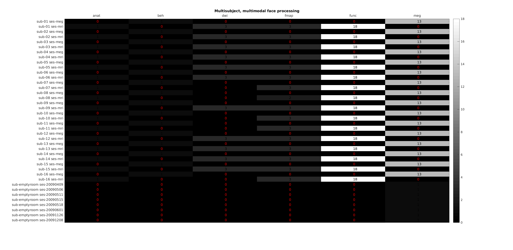
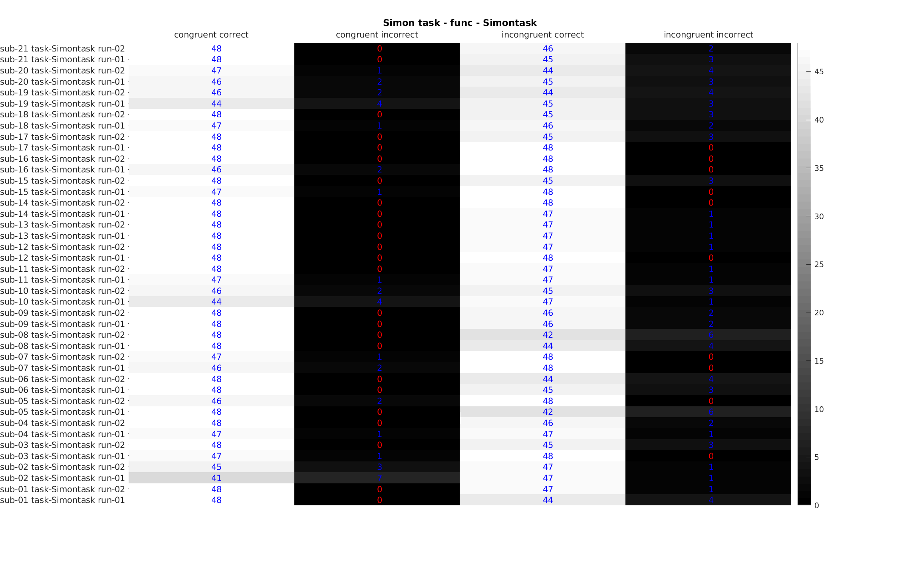
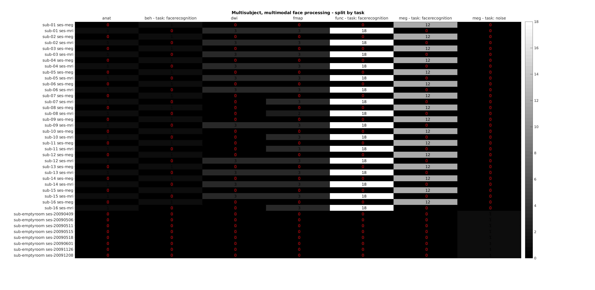

Function description
********************

.. mat:autofolder:: +bids/

.. autofunction:: +bids/derivatives_json.m

.. autofunction:: +bids/init.m

.. autoclass:: +bids/Description.m
    :members:

.. autofunction:: +bids/copy_to_derivative.m

.. autofunction:: +bids/report.m
.. autofunction:: +bids/validate.m

.. autofunction:: +bids/diagnostic.m

.. _fig_diagnostic:

   output of ``diagnostic``

.. _fig_diagnostic_events:

   output of ``diagnostic`` for events

.. _fig_diagnostic_task:

   output of ``diagnostic`` split by task
