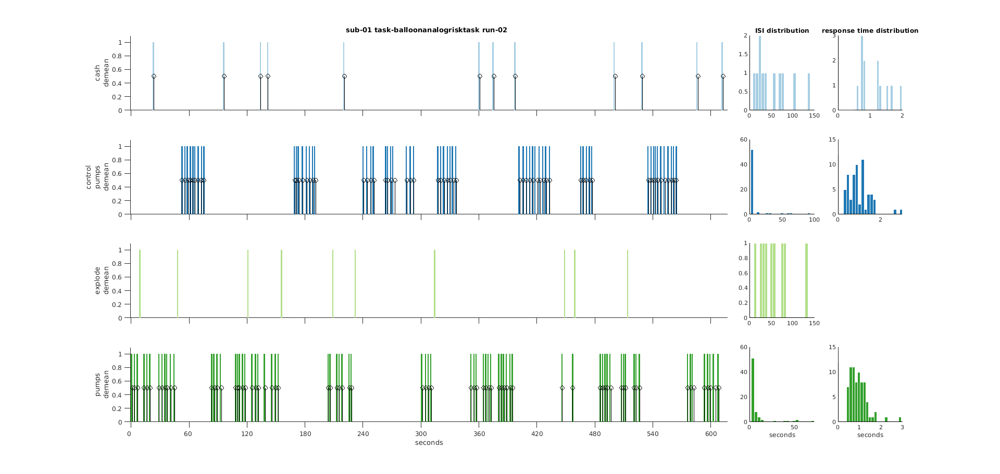

Utility functions
*****************

.. mat:autofolder:: +bids/+util/

.. autofunction:: +bids/+util/create_data_dict.m
.. autofunction:: +bids/+util/create_participants_tsv.m
.. autofunction:: +bids/+util/create_readme.m
.. autofunction:: +bids/+util/create_scans_tsv.m
.. autofunction:: +bids/+util/create_sessions_tsv.m
.. autofunction:: +bids/+util/download_ds.m
.. autofunction:: +bids/+util/jsondecode.m
.. autofunction:: +bids/+util/jsonencode.m
.. autofunction:: +bids/+util/mkdir.m
.. autofunction:: +bids/+util/plot_events.m

.. _fig_diagsnotic:

   output of ``plot_events``

.. autofunction:: +bids/+util/tsvread.m
.. autofunction:: +bids/+util/tsvwrite.m
